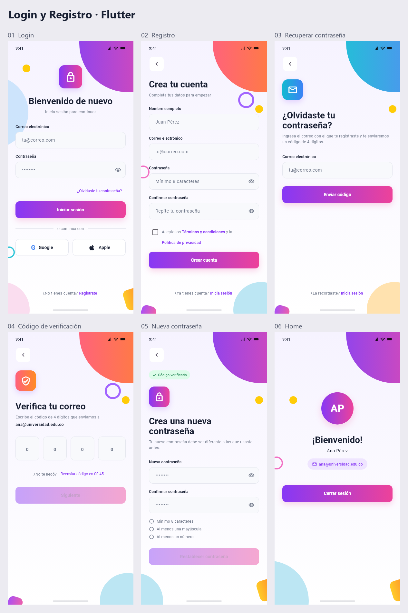

# Login y Registro - Aplicación móvil en Flutter

Aplicación móvil para **Android**, desarrollada en Flutter para el taller **Login y Registro (App móvil)**. Incluye las seis pantallas, navegación, validaciones y datos compartidos en memoria.

**Repositorio:** [areshuertas000-ai/maketacion](https://github.com/areshuertas000-ai/maketacion).

**Descargas:** [APK para Android ARM64](https://github.com/areshuertas000-ai/maketacion/releases/download/v1.0.0/Login_Registro_Android_ARM64.apk) · [Proyecto completo en ZIP](https://github.com/areshuertas000-ai/maketacion/releases/download/v1.0.0/Login_Registro_Flutter.zip).

APK compilado y probado en un emulador Pixel 6 con Android 17. [Ver captura de la app en Android](docs/android-login.png).

Referencia visual: [Login y Registro - App móvil en Figma](https://www.figma.com/design/auqlin8ZFmcTs8deTsAgYi/Login-y-Registro-%E2%80%93-App-m%C3%B3vil?node-id=0-1).



## Versiones y requisitos

- Flutter **3.44.9**, canal stable.
- Dart **3.12.2**, incluido en Flutter.
- Android SDK y un celular Android con depuración USB, o un emulador de Android Studio.
- Visual Studio Code con las extensiones Dart y Flutter, o Android Studio.

Las versiones corresponden al entorno de desarrollo. `pubspec.lock` conserva las dependencias. No se necesita Node.js, Firebase, base de datos ni servidor de autenticación.

## Ejecutar en Android

Abre la carpeta del proyecto en Android Studio o Visual Studio Code. Inicia un emulador desde **Device Manager** de Android Studio, o conecta tu celular Android por USB, activa **Depuración USB** y acepta la autorización que aparece en el celular.

Abre una terminal dentro de la carpeta del proyecto (donde está `pubspec.yaml`):

```bash
flutter --version
flutter pub get
flutter devices
flutter run -d ID_DEL_DISPOSITIVO
```

Reemplaza `ID_DEL_DISPOSITIVO` por el identificador del celular o emulador Android que muestra `flutter devices`. También puedes seleccionar ese dispositivo en Android Studio o VS Code y pulsar **Run**. No selecciones Chrome, Edge ni Windows para la entrega móvil.

Si Android no aparece, revisa `flutter doctor -v`. Si solicita aceptar licencias del SDK, ejecuta `flutter doctor --android-licenses`, lee cada licencia y decide si la aceptas.

## Instalar el APK en un celular

El archivo de entrega `Login_Registro_Android_ARM64.apk` es un instalador de depuración para el taller. Cópialo a un celular Android ARM64, ábrelo y sigue el instalador de Android. La app requiere Android 7.0 (API 24) o superior. Si Android solicita habilitar la instalación desde la aplicación con la que abriste el archivo, revisa ese permiso en el instalador.

## Probar el taller

1. **Login:** escribe `estudiante@universidad.edu.co` y `Prueba123`. Entra a Home, comprueba el correo y cierra la sesión.
2. **Registro:** pulsa Regístrate, completa nombre, correo y ambas contraseñas con `Prueba123`. Intenta crear la cuenta sin aceptar términos y revisa el error. Acéptalos y vuelve a enviarla.
3. **Recuperación:** pulsa ¿Olvidaste tu contraseña?, escribe un correo válido y pulsa Enviar código.
4. **Verificación:** escribe `1234`. El foco avanza automáticamente y al borrar vuelve a la casilla anterior. Espera 45 segundos para habilitar Reenviar código. El reenvío limpia las casillas y reinicia el contador.
5. **Nueva contraseña:** escribe `Nueva123`. Los tres requisitos pasan a cumplidos. Repite la misma contraseña y pulsa Restablecer contraseña. Regresarás a Login con el correo y un mensaje de éxito.
6. **Google y Apple:** ambos muestran “Funcionalidad no disponible”.

## Qué se simula

No hay backend. En Login se acepta cualquier correo con formato válido y cualquier contraseña no vacía. En Registro y Nueva contraseña se exigen al menos ocho caracteres, una mayúscula y un número. Cualquier código de cuatro dígitos es válido. No se envían correos reales, no se compara con un historial de contraseñas y no se guardan usuarios, sesiones ni contraseñas en el dispositivo. Al reiniciar la app, los datos desaparecen.

`AuthSession` transporta correo y nombre a Home. La recuperación transporta el correo a Verificación, Nueva contraseña y de regreso a Login. Los controladores se liberan al cerrar sus pantallas y el temporizador se cancela al abandonar su pantalla.

## Organización del código

```text
lib/
  main.dart                       Punto de entrada
  app.dart                        MaterialApp y tema
  models/auth_session.dart        Correo y nombre en memoria
  theme/app_theme.dart            Colores, degradado y tipografía
  utils/validators.dart           Validaciones reutilizables
  screens/
    login_screen.dart
    register_screen.dart
    recovery_screen.dart
    verification_screen.dart
    new_password_screen.dart
    home_screen.dart
  widgets/
    auth_scaffold.dart            Fondo decorativo y diseño adaptable
    auth_input.dart               Input con validación y ojo de contraseña
    auth_button.dart              Botón primario y secundario
    code_box.dart                 Casilla numérica reutilizable
    auth_parts.dart               Encabezados, pie, iconos y requisitos
test/
  auth_flow_test.dart              Interacción, navegación y adaptación
  validators_test.dart             Validaciones
```

## Requisitos implementados

| Requisito del taller | Implementación |
| --- | --- |
| Seis pantallas con un componente por pantalla | `lib/screens/` |
| Navegación y regreso correcto | `Navigator`; cierre de rutas al iniciar/cerrar sesión |
| Correo válido y campos obligatorios | `Form`, `TextFormField` y `Validators` |
| Mostrar y ocultar todas las contraseñas | `AuthInput` reutilizable |
| Confirmación y términos | Registro valida ambas condiciones antes de navegar |
| Cuatro casillas de un dígito | `CodeBox`, formatters y `FocusNode` |
| Contador y reenvío | `Timer.periodic`, bloqueo hasta cero y reinicio a 45 |
| Requisitos en tiempo real | `Requirement` y `setState` al escribir |
| Datos compartidos | `AuthSession` y parámetros de cada pantalla |
| Formularios inválidos | Login/Registro/Recuperación muestran errores; Verificación/Nueva contraseña deshabilitan el botón |
| Google y Apple | Mensaje de funcionalidad no disponible |
| Formato móvil y decoraciones | Referencia de 390 × 844, anchos adaptables, degradados y `CustomPainter` |

El contenido puede desplazarse en pantallas pequeñas o al abrir el teclado. En web se dibuja una barra de estado de referencia. En Android se conserva la barra nativa si el dispositivo informa su área segura.

## Validar y compilar

```bash
dart format --output=none --set-exit-if-changed lib test tool
dart analyze
flutter test
flutter build apk --debug --target-platform android-arm64
```

También puede usarse `flutter analyze`. El APK para instalar en celulares Android ARM64 se genera en `build/app/outputs/flutter-apk/app-debug.apk`. La compilación requiere que el Android SDK esté configurado y que hayas aceptado las licencias necesarias. Si necesitas incluir otras arquitecturas, usa `flutter build apk --debug`.

El proyecto conserva un destino web para vistas previas opcionales con `flutter run -d chrome`. La ejecución principal y el APK corresponden a Android.

Las capturas individuales están en `docs/pantallas/`. Para regenerarlas desde los widgets reales, ejecuta `flutter test tool/capture_screens.dart --update-goldens`.

## Descargar el código desde GitHub

```bash
git clone https://github.com/areshuertas000-ai/maketacion.git
cd maketacion
flutter pub get
flutter devices
flutter run -d ID_DEL_DISPOSITIVO
```

El código fuente, las pruebas y las capturas están en este repositorio. El APK, el ZIP y las sumas SHA-256 se encuentran en la [entrega v1.0.0](https://github.com/areshuertas000-ai/maketacion/releases/tag/v1.0.0). Las carpetas generadas `build/`, `.dart_tool/` y la configuración local de Android se excluyen del código versionado mediante `.gitignore`.
